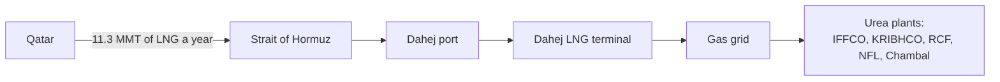
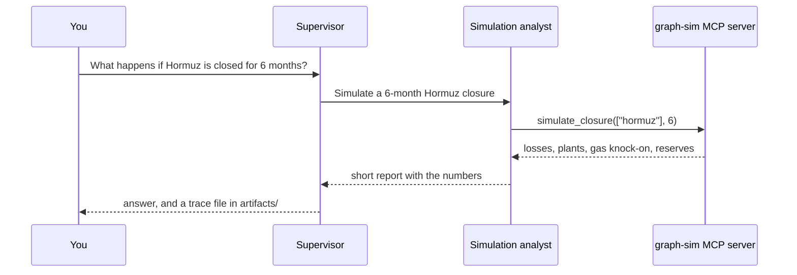

# How Flow works

India imports most of its crude oil, about half of its natural gas (as LNG) and a large share of its fertilizer, and nearly all of it comes by ship. Much of that shipping squeezes through a few narrow sea passages called chokepoints. If one of them closes, India does not lose one product. It loses several at once, and the damage spreads: less LNG means less gas for the plants that make urea.

Flow puts numbers on that. It keeps a cited record of who sells India what and which way each cargo travels. It reads the world's news every 15 minutes to see which chokepoints are in trouble, and it works out what India would lose if one of them closed.

## The big picture

```mermaid
flowchart LR
    seeds["Seed files<br/>cited numbers"] --> db[("flow.db<br/>SQLite")]
    gdelt["GDELT news<br/>every 15 min"] --> db
    db --> risk["Risk scores"]
    db --> graph["Route network<br/>NetworkX"]
    graph --> sim["Closure simulation"]
    db --> world["world-model<br/>MCP server"]
    risk --> world
    graph --> gs["graph-sim<br/>MCP server"]
    sim --> gs
    world --> agents["Copilot agents<br/>LangGraph + Groq"]
    gs --> agents
    risk --> api["API"]
    graph --> api
    agents --> api
    api --> ui["Dashboard"]
    db --> cli["Command line"]
```

Everything starts from one database file, `data/flow.db`. The dashboard, the command line and the AI agents all read from it. None of them write the numbers back.

## 1. The facts

The numbers live in small JSON files under `data/seeds/`. Every row says where it came from (PPAC, UN Comtrade, the Department of Fertilizers, EIA and others) and for which year. `flow data build` checks each row before loading it, so a missing source or a misspelled field stops the build instead of slipping through.

| In the data | Count |
| --- | --- |
| Supplier countries | 23 |
| Chokepoints | 5: Hormuz, Bab el-Mandeb, Suez, Malacca, Cape of Good Hope |
| Indian ports | 19 |
| Refineries | 23 |
| LNG terminals | 8 |
| Fertilizer plants | 7 |
| Strategic oil reserves | 3, holding 5.33 MMT |

MMT means million metric tonnes. India imported 241.8 MMT of crude oil and 27.8 MMT of LNG in 2024, and 5.6 MMT of urea, 4.6 MMT of DAP and 3.5 MMT of MOP in 2024-25.

Each supplier's cargo has a route: the chokepoints it passes and the Indian port and plant where it lands. Qatar's LNG goes through the Strait of Hormuz to Dahej. Oman's LNG and urea never enter Hormuz, because Oman ships from Sur and Qalhat, which sit outside the strait.

## 2. The news

GDELT is a free project that reads news sites around the world and publishes what it finds every 15 minutes. `flow data gdelt` downloads those files, keeps the articles about oil, gas, fertilizer and the places Flow tracks, and tags each article with the chokepoints, countries and products it mentions.

Flow turns those articles into a risk score from 0 to 100 for each chokepoint:

1. Each article that names the chokepoint is worth 1 point, plus 1 more point for every 5 points of negative tone. GDELT rates tone from about -10 (very negative) to +10.
2. Points lose half their value every 24 hours. Anything older than 72 hours is ignored.
3. The total is divided by the number of 15-minute slices in that window, so pulling more news does not inflate the score.
4. The result is squeezed into 0 to 100. About 2.5 points per slice gives 39, 5 gives 63 and 10 gives 86.

A score of 60 or more shows as Elevated, 35 to 59 as Watch, and anything lower as Nominal. At 14:00 UTC on 22 October 2026, Hormuz scored 75 and Bab el-Mandeb 68, after reports of tankers attacked in the Strait of Hormuz. Suez and Malacca were at 5 and the Cape at 0.

The score reflects news coverage only. Flow does not track ships.

## 3. The route network

Flow turns the routes into a network using the NetworkX library. Each route becomes a path from a supplier to an Indian plant:



The last two steps connect energy to farming. India pools gas for its urea plants, so every LNG terminal feeds one shared gas grid and the urea plants draw from it. Through that link a blocked strait becomes a fertilizer shortage. The Oxford study this project builds on (Verschuur, Lumma and Hall, Nature Communications, 2025) models each commodity on its own and does not capture it.

With the network in place, Flow can say how much passes through any point. The Strait of Hormuz carries 45% of India's crude oil imports, 52% of its LNG, 42% of its DAP, 16% of its urea and 8% of its MOP.

## 4. What if a chokepoint closes?

`flow simulate hormuz --months 6` (or the Simulate closure button on the dashboard) works through four steps:

1. Find every route through the closed chokepoint and treat it as blocked for the whole period.
2. Add up what those routes would have delivered in that time, by product, by port and by plant.
3. Work out the fertilizer knock-on. About 31% of India's natural gas goes to fertilizer plants (PPAC). A tonne of LNG holds about 12.3 Gcal of energy and the government's efficiency norm allows about 6.2 Gcal per tonne of urea, so every tonne of LNG the fertilizer plants lose is roughly two tonnes of urea they cannot make.
4. Check how many days the strategic oil reserves could replace the missing crude, and list the suppliers whose routes still work.

For a six-month closure of the Strait of Hormuz:

| Product | Lost in 6 months | Share of imports |
| --- | --- | --- |
| Crude oil | 54.2 MMT | 45% |
| LNG | 7.2 MMT | 52% |
| DAP | 0.95 MMT | 42% |
| Urea | 0.45 MMT | 16% |
| MOP | 0.14 MMT | 8% |
| Urea that cannot be made for lack of gas | about 4.5 MMT | |

The missing crude would have gone to Reliance Jamnagar (about 25 MMT), Nayara Vadinar (18.5 MMT) and IOC Koyali (10.6 MMT). The three strategic reserves, 5.33 MMT in all, would cover about 18 days of it. The biggest crude supplier left untouched is Russia, whose 92 MMT a year comes around the Cape of Good Hope.

## 5. Asking questions

The Copilot answers questions in plain English. Behind it are three AI agents built with LangGraph and running on Groq:



The supervisor reads the question and hands parts of it to one or both specialists. The risk analyst looks things up in the database: scores, recent articles and import mix. The simulation analyst uses the route network and the simulator. Neither specialist touches the database or the Python code directly. They work through two MCP servers, `world-model-mcp` and `graph-sim-mcp`. (MCP is a standard way to give AI agents tools.) Every run is saved in `artifacts/` as a JSON trace that lists each hand-off, tool call and result, so anyone can check where an answer came from.

The Copilot needs a free Groq API key. The rest of Flow works without one.

## The dashboard

The dashboard is a single screen that refreshes every minute. Across the top is a risk card for each chokepoint, each with a small trend line. Below that is a map of the lanes from each chokepoint to the Indian ports it feeds, where thicker lines carry more tonnes and the colour shows risk. Beside the map is the news for the selected chokepoint. At the bottom is India's import share through that chokepoint, with a Simulate closure button. Ask Copilot, in the top corner, opens the chat.

## Running it

```bash
uv sync --group dev                  # install
uv run flow data build               # build the database
uv run flow data gdelt --slices 4    # fetch the last hour of news
cd frontend && npm install && npm run build && cd ..
uv run flow serve                    # then open http://127.0.0.1:8000
```

## What Flow does not do yet

- Each supplier's cargo is sent to one main port and plant. In reality, Iraqi crude is split across many refineries.
- A closed chokepoint blocks its routes completely. Flow does not send ships on detours, such as the Lombok Strait instead of Malacca.
- When LNG runs short, Flow assumes every gas user loses the same share. In practice the government may protect fertilizer plants first.
- GDELT gives a link but no headline, so the headlines on screen are rebuilt from the web address.
- Routes are fixed 2024 paths chosen by the team. All Russian crude, for example, is routed around the Cape, so in Flow's numbers a Red Sea closure does not touch it.

## Words used here

| Word | Meaning |
| --- | --- |
| Chokepoint | A narrow sea passage that many ships must use, like the Strait of Hormuz |
| LNG | Liquefied natural gas, shipped cold as a liquid |
| Urea, DAP, MOP | The three main fertilizers India imports: nitrogen, phosphate and potash |
| MMT | Million metric tonnes |
| SPR | Strategic petroleum reserve: crude stored underground for emergencies |
| GDELT | A free global news database, updated every 15 minutes |
| MCP | Model Context Protocol, a standard way to give AI agents tools |
| Gcal | Gigacalorie, a unit of energy |
